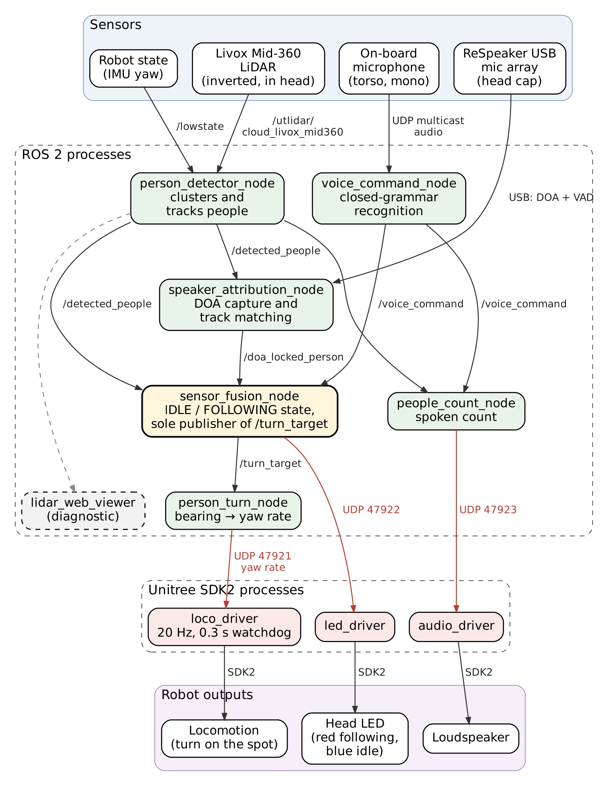
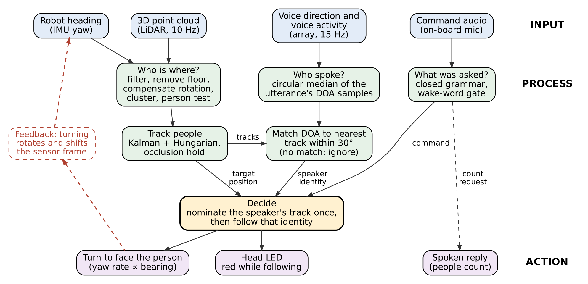

# Speaker Attribution on a Unitree G1 Humanoid

When several people share a room with a robot, a spoken command does not say who gave it. This system lets a Unitree G1 humanoid answer that question. It fuses the **direction of a voice**, measured by a four-microphone USB array on the robot's head, with the **positions of people** tracked by the robot's head-mounted 3D LiDAR. When someone says *"Hey Stuart, follow me"*, the robot works out which tracked person spoke, locks onto that person's track, and turns to face them as they move.

Everything runs on the robot's on-board computer under ROS 2. The person tracker is geometric and needs no training data.

- **Demo video:** [YouTube](https://youtu.be/YceLhczXzpk) <!-- replace once uploaded -->
- **Dissertation:** A. T. Hutchison, *Speaker Attribution by Fusing Acoustic Direction-of-Arrival with 3D LiDAR Person Tracking on a Humanoid Robot*, BAdvCompSc (Hons) dissertation, The University of Western Australia, 2026.

---

## What the robot does

| Say | The robot |
|---|---|
| "Hey Stuart, follow me" | Matches your voice direction to your LiDAR track, then turns to keep facing you. Head LED turns red. |
| "Hey Stuart, closest" | Follows whoever is nearest, without using voice direction. |
| "Hey Stuart, how many people do you see?" | Says how many people it is tracking and how far away the nearest is. |
| "Stop" | Stops following immediately. No wake word needed, at any time. |

"Eloise" also works as a wake word. Starting motion needs the wake word, but stopping never does. The robot turns on the spot; it does not walk toward people.

## How it works



Three questions are answered in parallel and combined once, when a command arrives:

- **Who is where?** `person_detector_node` clusters the LiDAR point cloud into people and tracks them with persistent IDs (Kalman filter + optimal assignment). It compensates for the robot's own rotation using the IMU yaw, and holds a person's track while they are hidden behind one of the head's two support struts.
- **Who spoke?** `speaker_attribution_node` reads the array's on-chip direction-of-arrival (DOA) and voice-activity estimates over USB. It takes the circular median of the DOA samples across the whole utterance, and matches that bearing to the nearest track within 30°. If no track is within 30°, nothing is attributed.
- **What was asked?** `voice_command_node` runs a closed-grammar Vosk recogniser on the robot's built-in microphone stream.

`sensor_fusion_node` nominates the speaker's track once, then follows that track's identity, not the voice. `person_turn_node` turns the target's bearing into a yaw rate.

ROS 2 (`rclpy`) and the Unitree SDK cannot share a process on this robot, so every actuator has its own SDK-only driver. Each driver listens on a localhost UDP port:

| Port | Driver | Output |
|---|---|---|
| 47921 | `loco_driver` | Locomotion (yaw rate) |
| 47922 | `led_driver` | Head LED |
| 47923 | `audio_driver` | Speech |



## Hardware

- **Unitree G1** humanoid with the on-board NVIDIA Jetson Orin NX development computer. The front head visor was removed, because it blocked about 60° of the LiDAR's forward view.
- **Livox Mid-360 LiDAR.** Built into the G1's head, mounted upside down; publishes `/utlidar/cloud_livox_mid360`.
- **Seeed ReSpeaker USB Mic Array v2.0** (XMOS XVF-3000, four microphones), plugged into the robot by USB. It sits on a 3D-printed cap shaped to the top of the head, on a stack of sorbothane and open-cell foam to isolate it from vibration.
  - The cap and every layer must be rotationally symmetric about the array's vertical axis, because any asymmetry biases the DOA reading.
  - The cap was modelled by subtracting Unitree's `head_link.STL` (from [`unitree_ros`](https://github.com/unitreerobotics/unitree_ros), `robots/g1_description/meshes/`) from a cylinder.
- **A laptop** on the same network, only to open SSH sessions and the browser viewer. Nothing in the sensing or control path runs off the robot.

## Software requirements (on the robot)

- Ubuntu 20.04, ROS 2 Foxy with CycloneDDS, **system** Python 3.8. Do not `conda activate` anything: Foxy's `rclpy` only works with the system interpreter.
- Python packages: `requirements.txt`.
- `ros-foxy-sensor-msgs-py` (apt).
- [`unitree_sdk2_python`](https://github.com/unitreerobotics/unitree_sdk2_python) for the three drivers.
- A built [`unitree_ros2`](https://github.com/unitreerobotics/unitree_ros2) CycloneDDS workspace. It provides the `unitree_hg` / `unitree_go` messages that the detector uses to read the IMU yaw.
- Vosk model [`vosk-model-small-en-us-0.15`](https://alphacephei.com/vosk/models).

## One-time setup

```bash
# 1. Clone so that the nodes end up in ~/aidan/sensor_fusion (the scripts expect this path)
git clone https://github.com/aidan-hutchison/g1-speaker-attribution.git ~/aidan

# 2. Dependencies (system Python, no conda)
sudo apt install ros-foxy-sensor-msgs-py
pip3 install -r ~/aidan/requirements.txt
git clone https://github.com/unitreerobotics/unitree_sdk2_python.git ~/unitree_sdk2_python
pip3 install -e ~/unitree_sdk2_python

# 3. unitree_ros2 messages (unitree_hg / unitree_go), built per that repo's instructions.
#    If your workspace is not at ~/unitree_ros2_TESTCLONE/cyclonedds_ws, set UNITREE_MSGS_WS (step 6).

# 4. Vosk model: download and unzip vosk-model-small-en-us-0.15, then set VOSK_MODEL (step 6)

# 5. Microphone array: allow non-root access to its USB control interface
sudo cp ~/aidan/config/99-respeaker.rules /etc/udev/rules.d/
sudo udevadm control --reload-rules && sudo udevadm trigger

# 6. Shortcuts (t1 … t12). Override paths before sourcing if yours differ:
echo 'export VOSK_MODEL=$HOME/models/vosk-model-small-en-us-0.15' >> ~/.bashrc   # example
echo 'source ~/aidan/scripts/g1_shortcuts.sh' >> ~/.bashrc
```

On the laptop, copy `scripts/g1_laptop.sh` to `~/` and source it from `~/.bashrc`, with `G1_HOST=unitree@<robot-ip>` exported. Then:

- `g1 t3` runs a shortcut on the robot over SSH.
- `g1up` opens one terminal tab per process.

**CycloneDDS:** `g1env` sets `RMW_IMPLEMENTATION=rmw_cyclonedds_cpp` and `CYCLONEDDS_URI=~/cyclonedds_ws/cyclonedds.xml`, matching the robot's own login environment. DDS must use `eth0` only: if `wlan0` is also listed in that file, discovery still works but data is silently not delivered.

## Calibrate before first use

Do these checks once per robot, and again if the microphone mount is moved. Do not assume the conventions; check them physically.

1. **Heading sign.**
   - `python3 odom_check.py` (from `~/aidan/sensor_fusion`, with `g1env` sourced) checks the IMU yaw direction: turning the robot 90° left should read about +90°.
   - The detector's `heading_sign` also depends on the LiDAR frame, which on the evaluated robot is mirrored relative to the body, hence −1.
   - Confirm it with the detector itself: with a person standing still, turn the robot by hand. Their track should keep its ID and position; if it runs away from them, flip the sign.
2. **DOA offset and sign.**
   - Follow the calibration procedure in the docstring of `speaker_attribution_node.py`: speak from straight ahead, then from 90° left, and record the raw readings.
   - Then run `python3 doa_calibration_check.py --offset <offset> --sign <sign>` and walk round 12 marks at 30° spacing.
   - The evaluated mount used offset 0° and sign −1.
   - **Test in both directions round the marks.** The array's estimate leans 5–7° toward the previous sound's direction, so a one-way test mistakes that lean for a fixed offset.
3. **Voice-activity threshold.** The array's `GAMMAVAD_SR` has been found reset to 15 dB (instead of 3.5) after power cycles, which almost disables voice detection. `t2` writes 3.5 before starting the node. To check by hand, run `python3 tuning.py GAMMAVAD_SR`.

## Running

Open one terminal per process (or run `g1up` on the laptop):

```text
g1pre   stop the vendor voice service (frees the audio), show disk space
t1      person_detector_node        T6  loco_driver   (asks you to confirm the robot is standing)
t2      speaker_attribution_node    T7  led_driver
t3      voice_command_node          T8  audio_driver
t4      sensor_fusion_node          T9  people_count_node
t5      person_turn_node            T10 lidar_web_viewer -> http://<robot-ip>:8090
g1check list nodes and key detector parameters
```

1. Start `g1pre`, `t1`, `t2`, `t3` and `t4`, and check their logs.
2. Start `t5`.
3. Stand the robot up with the remote: **L2+B → L2+UP → R2+A → START**.
4. Start `t6`, then `t7`, `t8`, `t9` and `t10` as needed.
5. Say "Hey Stuart, follow me".

**Stopping:** say "Stop", or stop `t6`. `loco_driver` has a 0.3 s watchdog, so the robot stops by itself if the turn node or anything upstream dies. Keep the remote in hand.

**Recording:**

| Shortcut | Records |
|---|---|
| `t11 <name>` | A ROS 2 bag of the system topics |
| `t11raw <name>` | The same, plus raw LiDAR and IMU (about 0.5 GB/min) for offline replay |
| `mark <text>` | Puts a labelled marker into the bag |

## Evaluated configuration

The shortcuts launch the configuration used for every result in the dissertation (frozen 29 September 2026). Only launch arguments are set here; everything else is the node default.

| Node | Settings |
|---|---|
| `person_detector` | `max_range` 2.1 m, `range_edge_margin` 0.1 m (effective range 2.0 m), background filter off, `coast_secs` 0.5, `heading_source` lowstate, `heading_sign` −1; occlusion hold on (strut sectors 30–60° and 300–330°, up to 10 s) |
| `speaker_attribution` | offset 0°, sign −1, 30° match tolerance, 2.5 s capture window, 0.5 s silence grace, 20 s lock |
| `voice_command` | 5 s wake window, closed grammar |
| `person_turn` | Kp 2.0, 8° dead zone, max 0.8 rad/s, input `/turn_target`, 0.5 s lost timeout, search sweep off |
| `loco_driver` | 20 Hz, 0.3 s watchdog, max 0.8 rad/s |

## Repository layout

```text
sensor_fusion/                 everything that runs on the robot (run from this folder)
  person_detector_node.py      LiDAR person detection and tracking
  speaker_attribution_node.py  DOA capture and DOA-to-track matching
  voice_command_node.py        closed-grammar command recognition
  sensor_fusion_node.py        IDLE/FOLLOWING state; sole publisher of /turn_target
  person_turn_node.py          bearing -> yaw rate
  people_count_node.py         spoken "how many people" answer
  loco_driver.py               SDK bridge: yaw rate -> locomotion (UDP 47921)
  led_driver.py                SDK bridge: head LED (UDP 47922)
  audio_driver.py              SDK bridge: speech (UDP 47923)
  tuning.py                    ReSpeaker USB parameter access (Seeed, see Credits)
  lidar_web_viewer.py          browser view of the cloud and tracks (diagnostic)
  doa_calibration_check.py     12-mark DOA calibration check
  odom_check.py                heading-sign / odometry check
scripts/
  g1_shortcuts.sh              robot shortcuts t1 … t12 (evaluated launch arguments)
  g1_laptop.sh                 laptop shortcuts: g1, g1up, g1pull
config/99-respeaker.rules      udev rule for the microphone array
docs/                          architecture figures
```

## Known limitations

- **Range:** people are detected within 2.0 m of the robot.
- **Blind sectors:** the two head struts hide about 30° on each side of the front. A person who is first seen while standing in the middle of one may not be detected.
- **One speaker at a time.** Overlapping speech gives a single DOA, which may point between two people.
- **Close separations:** two people need to be about 30° or more apart, as seen from the robot, to be told apart reliably. The DOA carry-over effect makes closer separations depend on who spoke last.
- **Turning only:** the robot turns on the spot. Walking would need translation compensation, because the G1 drifts 0.1–0.25 m when it turns.
- **Hidden too long:** a person hidden behind something other than the struts for more than about 3.3 s is given a new identity, and following ends.

## Credits

- Developed by Aidan Hutchison for an Honours project at The University of Western Australia, supervised by Prof. Thomas Bräunl, A/Prof. Tim French and Dr David Goyeneche.
- `tuning.py` is Seeed Studio's ReSpeaker USB Mic Array tuning script, from [respeaker/usb_4_mic_array](https://github.com/respeaker/usb_4_mic_array).

## Licence

<!-- Choose a licence (e.g. MIT) after checking with your supervisor; tuning.py keeps Seeed's original terms. -->
